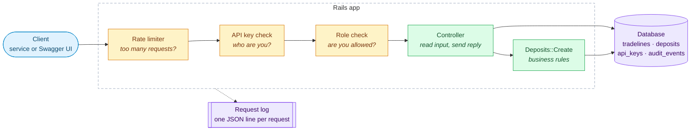
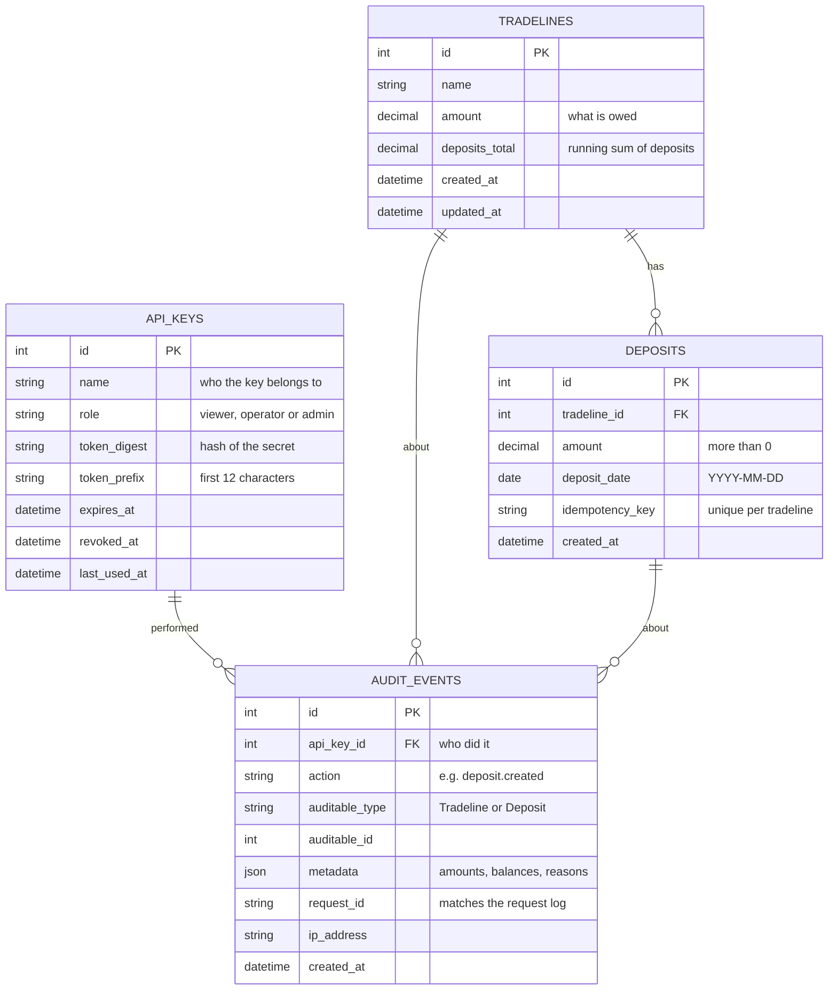
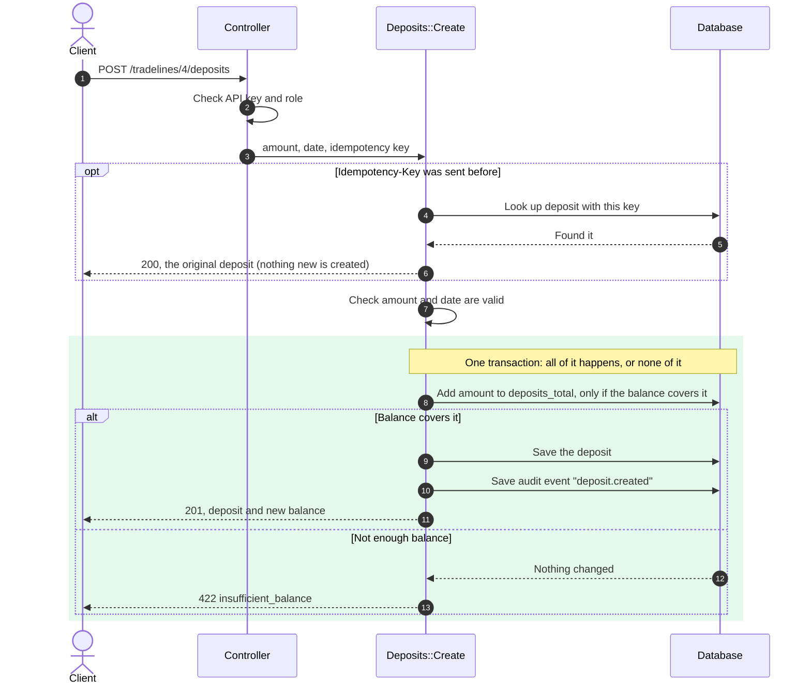
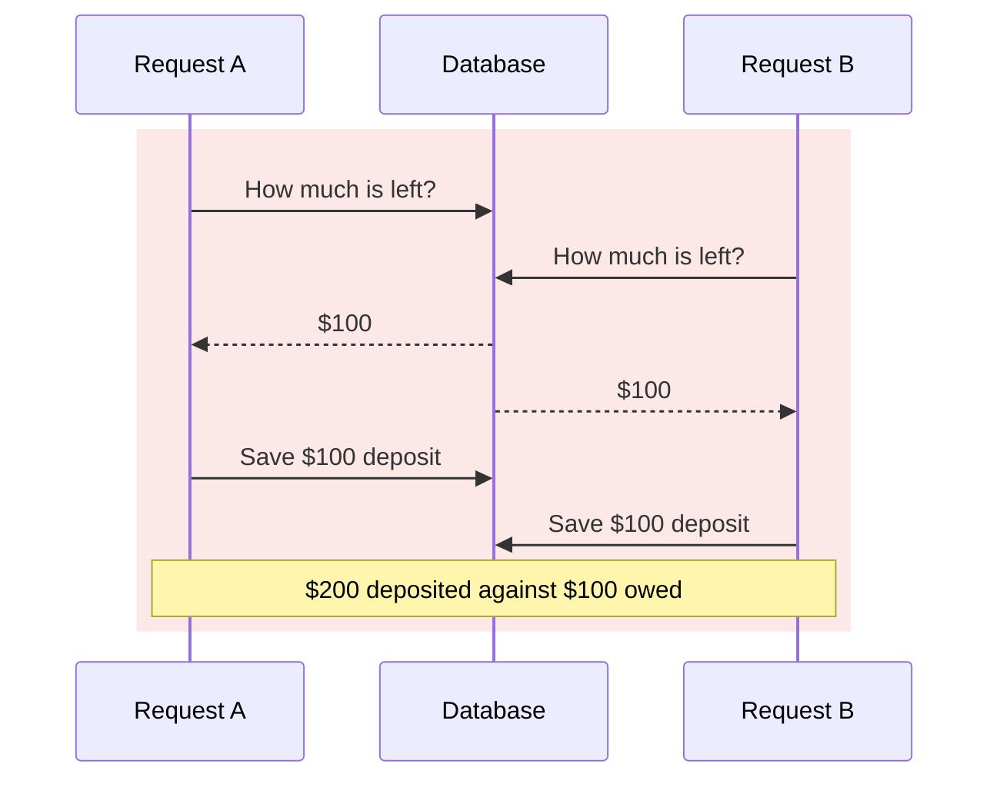
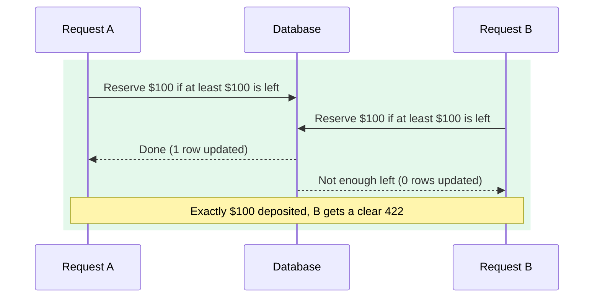
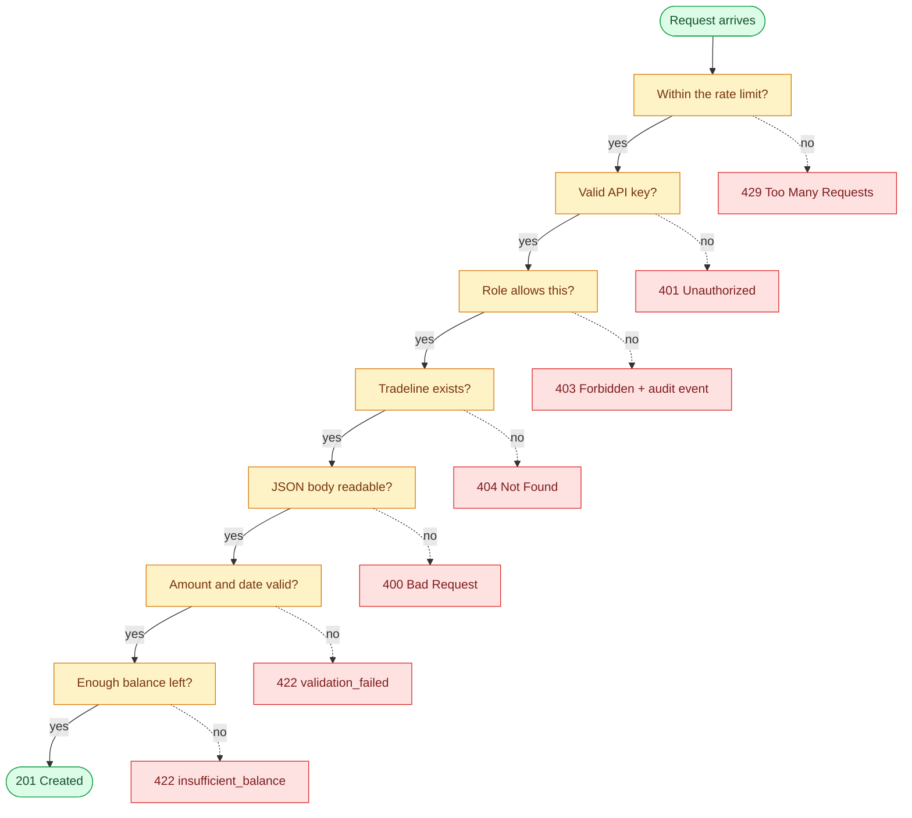
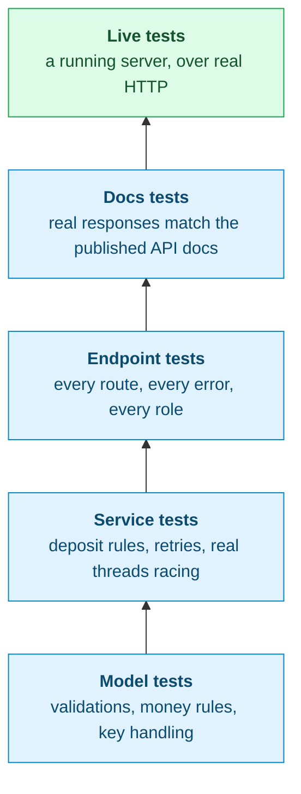

# Design

How the Deposits API works, and why it's built this way.
For setup and usage, see the [README](README.md).

- [The big picture](#the-big-picture)
- [Data model](#data-model)
- [Creating a deposit](#creating-a-deposit)
- [Two deposits at the same moment](#two-deposits-at-the-same-moment)
- [What a request goes through](#what-a-request-goes-through)
- [Access control](#access-control)
- [Audit log](#audit-log)
- [Money and dates](#money-and-dates)
- [How it's tested](#how-its-tested)
- [Trade-offs](#trade-offs)
- [Surprises along the way](#surprises-along-the-way)
- [What I'd do next](#what-id-do-next)

---

## The big picture

Every request passes through a few checkpoints before it reaches the business rules.



- **Controllers stay thin.** They read the request and format the reply.
- **`Deposits::Create` holds the deposit rules** in one place, so they're easy to read and test.
- **The database enforces the important rules too**, as a safety net under the code.

## Data model



**Outstanding balance = `amount` − `deposits_total`.**

`deposits_total` is a running total that's updated whenever a deposit is added. Reading a balance is then instant, and listing tradelines doesn't add up every tradeline's deposits on each request. The `deposits:reconcile` task checks that each running total still matches the actual deposits.

**Rules the database enforces on its own**, even if the code had a bug:

| Rule | Where |
|---|---|
| A deposit's amount is more than 0 | `deposits` |
| Total deposits never go below 0 | `tradelines` |
| Total deposits never exceed the amount owed | `tradelines` |
| An idempotency key is used once per tradeline | `deposits` (unique index) |
| A role is `viewer`, `operator` or `admin` | `api_keys` |

## Creating a deposit



The key step is **step 8**. Checking the balance and reserving it happen in **one database statement** (simplified here; the real one compares whole cents, see [Surprises](#surprises-along-the-way)):

```sql
UPDATE tradelines
SET    deposits_total = deposits_total + 250.00
WHERE  id = 4
  AND  amount - deposits_total >= 250.00   -- only if there's enough left
```

If the database reports that it updated one row, the money is reserved. If it updated zero rows, there wasn't enough balance and nothing changed. The next section explains why this matters.

## Two deposits at the same moment

Say a tradeline has **$100 left**, and two requests each try to deposit **$100** at the same time.

**The obvious way: check first, then save.** Both requests check, both see $100 left, and both save.



**The way this app does it: check and reserve in one step.** The database runs one update at a time, so the second request sees the first one's change.



Tests prove this with real threads, and over real HTTP with 10 requests at once: exactly as many deposits succeed as fit, and the balance never goes below zero.

## What a request goes through

Each check can stop the request with its own status code:



The role check happens **before** the tradeline lookup. That way, someone without access can't find out which tradeline IDs exist by watching for 404s.

## Access control

**API keys, not user logins.** This API is meant to be called by other systems (a billing service, for example), not by people in a browser. A key per system is simple, can be switched off instantly, and makes the audit log show which system did what.

How keys are kept safe:

- A key is `dpx_` followed by 43 random characters. It's shown **once**, when it's created.
- The database stores only a **hash** of the key, so a copy of the database doesn't give anyone working keys.
- Keys can **expire** and be **revoked**. A wrong, expired or revoked key all get the same `401`, so a caller can't tell which it was.
- Keys are only accepted in the `Authorization` header, never in the URL, where they'd end up in logs.

Three roles cover the needs:

| | Read | Create deposits | Create tradelines | Read audit log |
|---|:-:|:-:|:-:|:-:|
| **viewer** | ✓ | | | |
| **operator** | ✓ | ✓ | | |
| **admin** | ✓ | ✓ | ✓ | ✓ |

The permissions live in one small map (`ApiKey::PERMISSIONS`), so they're easy to review.

## Audit log

Everything that touches money or security is written to `audit_events`, and those rows can't be edited or deleted.

| Event | When |
|---|---|
| `tradeline.created` | An admin creates a tradeline |
| `deposit.created` | A deposit is saved, with the balance before and after |
| `deposit.rejected` | A deposit is refused, with the reason |
| `deposit.idempotent_replay` | A retry returns an existing deposit |
| `authorization.denied` | A key tries something its role doesn't allow |

- A deposit and its audit event are saved **together**: either both are saved or neither is. There's never a deposit without a record of who made it.
- Each event stores the **request ID**. The same ID is in the response header (`X-Request-Id`) and the request log, so you can follow one request from the client, through the logs, to the audit log.
- Failed logins (401) go to the request log, not the audit table, so anonymous traffic can't fill up the table.

## Money and dates

- **Money is never a floating-point number.** Amounts use exact decimals in the database and code, and are returned as text (`"250.00"`) so clients don't round them.
- **Fractions of a cent are rejected, not rounded.** `10.005` gets an error. Silently changing someone's amount would be worse.
- **Dates must be `YYYY-MM-DD`.** Formats like `10/11/2026` could mean October or November, so they're rejected. Impossible dates like `2026-02-30` are rejected too.
- **Past dates are allowed.** The assignment says the date is *most likely* in the future, not always, so a back-dated deposit is accepted.
- **Deposits can't be changed or deleted.** A mistake would be fixed with a correcting entry, which keeps the history intact.

## How it's tested



- **255 tests** run with `bundle exec rspec`, plus **12 live tests** with `bin/integration`. Line coverage is about 99%.
- The authentication test finds every route automatically, so a new endpoint can't skip the API key check by accident.
- The API docs are **generated from tests** that check real responses against the documented format. If the docs and the code disagree, the build fails.
- GitHub Actions runs everything on every push, and also fails if the published docs are out of date.

## Trade-offs

| Decision | Chosen | Not chosen | Why |
|---|---|---|---|
| Keeping balances correct | One update that checks and reserves in a single step | Check first, then save | The obvious way lets two requests overdraw. See [above](#two-deposits-at-the-same-moment). |
| | | Locking the row | SQLite doesn't support row locks, and one update is simpler anyway. |
| Reading balances | Stored running total | Adding up deposits on every read | Instant reads, and listing tradelines stays fast. The cost is one extra column to keep in sync, which the reconcile task checks. |
| Authentication | API keys, stored as hashes | User accounts and sessions | The clients are other systems, not people. |
| | | JWT tokens | A JWT can't be cancelled before it expires. An API key can be revoked instantly. |
| Hashing keys | SHA-256 | bcrypt | bcrypt protects weak passwords. These keys are long and random, so a fast hash is safe and keeps every request quick. |
| Permissions | One small permission map | An authorization gem (e.g. Pundit) | Three roles and five permissions don't need a framework. |
| Audit trail | A database table, saved with the change | Logs only | Logs can be lost or rotated. A table saved in the same step can't miss an event. |
| Retries | `Idempotency-Key` stored on the deposit | A separate table or Redis | Easy to reason about, and a unique index blocks duplicates even when retries race each other. |
| Pagination | Page info in response headers | Wrapping lists in `{data, meta}` | The tradelines list kept its original shape, so existing clients don't break. |
| Money format | Text with two decimals | JSON numbers | Many JSON clients read numbers as floats, which can change amounts. |
| Database | SQLite (as provided) | PostgreSQL | Fine for the exercise. The balance logic works unchanged on PostgreSQL. |
| Rate-limit storage | In memory | Redis | Fine for one server. With several servers it should move to Redis so limits are shared. |
| API docs | Generated from tests (rswag) | Written by hand | Hand-written docs drift from the code. These can't. |
| Docs visibility | Public, calls still need a key | Behind a login | Easier to explore. Can be turned off with `API_DOCS_ENABLED=false`. |

## Surprises along the way

**SQLite stores decimals as floating-point numbers.** In SQLite, `3223.54 − 3000.00` comes out as `223.5399999…`, so depositing the exact remaining `223.54` would have been refused. The balance check now compares whole **cents**. A test covers this exact case.

**Busy SQLite blocked the whole app.** When two requests wrote at the same time, the waiting one held Ruby's global lock (the GVL) while it waited, so the request it was waiting for couldn't finish. The result was `database is locked` errors under normal concurrent traffic. The concurrency tests caught it. A small fix (`config/initializers/sqlite_busy_handler.rb`) waits without holding the GVL, which is how Rails 8 handles it.

**Unused Rails features opened extra doors.** The default Rails setup included email-ingestion and file-upload features with their own public URLs, outside the API key check. The app now loads only the parts of Rails it uses.

## What I'd do next

- **Move to PostgreSQL** for many servers writing at once, and share the rate limits through Redis.
- **Give deposits a lifecycle:** scheduled → processing → settled, failed or cancelled, with corrections as reversing entries.
- **Rotate keys smoothly** by letting an old and a new key work side by side for a while.
- **Make the audit log tamper-proof** by copying it to write-once storage.
- **Support more than one currency** by storing a currency code per tradeline.
- **Add metrics and alerts**: deposit volume, rejection rate, errors, and an alert if the reconcile task finds a mismatch.
